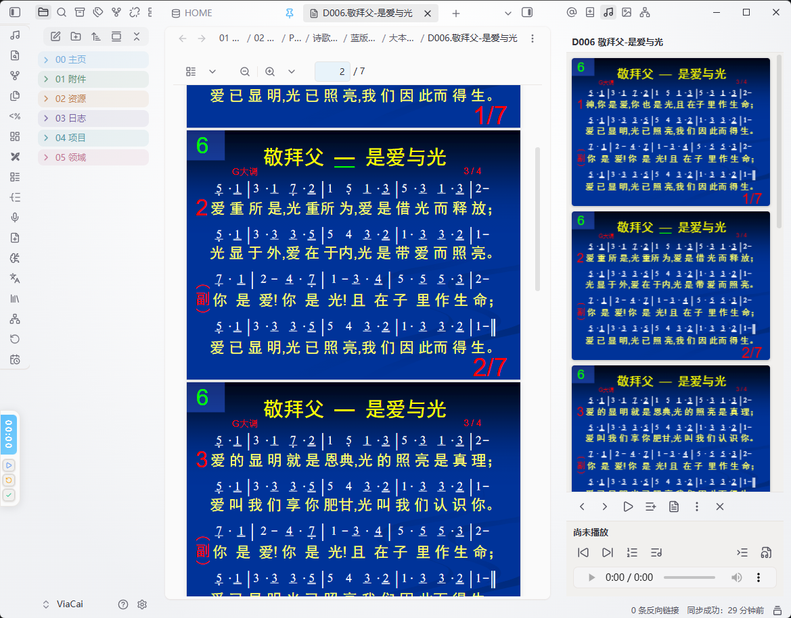

# Hymns（诗歌）Obsidian 插件

诗歌浏览、搜索、播放与收藏插件：按编号（如 `D116`）或关键词（空格分隔，如 `恩典 耶稣`）实时搜索，预览 PDF，播放 MP3，收藏与播放列表。桌面端与移动端通用。仅支持大本诗歌 / 补充诗歌 / 唱诗人 / 新歌颂咏 / 儿童诗歌 / 青年诗歌 / 特会诗歌

注意：插件本体约 1.5 MB，由于诗歌PDF（约 535 MB）与 MP3（约 3.79 GB）体积较大，请到 QQ 群 1128049033 另行下载，解压到你 Obsidian 仓库的任意位置。obsidian启动时，插件会自动扫描仓库中的诗歌PDF与MP3，并自动创建诗歌索引和歌词索引。



## 功能

- **实时搜索**：按编号或关键词即时过滤，分组展示（大本诗歌 / 补充诗歌 / 唱诗人 / 新歌颂咏 / 儿童诗歌 / 青年诗歌 / 特会诗歌 / 其他）。
- **PDF 预览**：单击诗歌在侧边栏查看，双击诗歌在主视图查看。
- **MP3 播放**：一键播放诗歌音频，支持顺序 / 单曲循环 / 列表循环；可切换音频来源。
- **收藏与播放列表**：收藏诗歌；内置 7 个主题歌单（倪柝声 / 李常受 / 余洁麟 / 和受恩 / 霍华德 / 以撒·华滋 / 约翰·牛顿），也可自建歌单。
- **联动**：可在底部播放栏「联动」里勾选 MP3 随 PDF 切换以及 PDF 随 MP3 切换。
- **复制链接或嵌入笔记**：可将诗歌 PDF 或 MP3 嵌入笔记，或者复制链接到笔记。
- **分享 / 复制文件**：在诗歌右边的「⋯」菜单里点「分享 PDF」或「分享 MP3」，就能把文件交给其它软件。
  - **手机（安卓 / iOS）**：弹出系统分享面板，直接选微信、QQ 等发出去。
  - **电脑**：因为电脑没有系统分享面板，所以改成**复制文件本身**——点一下，文件就进了剪贴板（等同于在文件夹里选中它按 `Ctrl+C`），再到微信 / QQ 窗口按 `Ctrl+V`（⌘V）粘贴即可。
  - 万一某台电脑复制不了，会自动打开这个文件所在的文件夹并选中它，按 `Ctrl+C` 就能复制；同时也会把文件的完整路径复制好。
- **长按定位**：搜索结果里长按一首诗歌，跳到它在分类中的位置；搜索框右侧出现返回按钮，点击回到原搜索界面（位置保留），重新输入检索则自动消失。
- **PDF 滑动切歌**：侧边栏预览 PDF 时左右滑动（或鼠标拖拽）即可切到上一首 / 下一首。
- **窗口投影**：在「更多」菜单选「窗口投影」，或预览 PDF 时直接按 `P`，即进入单页投影（一个屏幕一页）。
  - 翻页：左右按钮、方向键 / PageUp / PageDown、**鼠标滚轮**、触屏左右滑动；`Home` / `End` 跳首末页。
  - 播放：右上角 ▶ 或**空格键**打开底部播放条并播放这首诗歌的 MP3，可暂停 / 拖进度 / 看时间；播放条会让出下方空间并让页面重新排版，**绝不挡住 PDF 的字**。
  - 窗口模式（默认）：只占满 Obsidian 窗口，顶部把手按住可拖动投影位置（双击复位）；投影中再按 `P`、或 `Esc`、或点右上角 ✕，都能退出投影。
  - 整屏投影（桌面端）：在「更多」菜单选「全屏投影」可一步进整屏；预览 PDF 时按 `O` 直接打开整屏投影，再按 `O` 关闭（窗口模式投影已开时按 `O` 会放大到整屏）；整屏内按 `O` / `Esc` 直接退出整个投影。
  - 页面自动等比适配：区域偏宽时适应高度（左右留黑边），区域偏高时适应宽度（上下留黑边），任何比例下都不会超出界面或被裁切。
- **文件名不带歌名也能显示歌名**：儿童诗歌（`E001`）、新歌颂咏（`X001`）这类只叫编号的 PDF，歌名只印在 PDF 正文里；插件会用歌词索引里从正文抽出的标题自动补齐，列表、搜索、歌词页都会显示真正的歌名。扫描版（无文本层）的 PDF 抽不出标题，仍显示分类名。
- **可自行更换 PDF 和 MP3**：如果你有更好的 PDF 或 MP3 资源，可自行替换原始文件，也可新增文件，只要按照命名规律改名字即可。

### 文件命名与配对规则

插件靠文件名把 PDF 和 MP3 配成一对：

| PDF | 对应 MP3 | 说明 |
| --- | --- | --- |
| `D001.…pdf` | `d001.mp3` | 正歌：字母 + 补零编号 |
| `Ds1.…pdf` / `C附2…pdf` | `d-1.mp3` / `c-2.mp3` | 附录（短歌、补充）：MP3 用**字母 + 横杠 + 数字** |
| `D388-1…pdf`（第 2 版） | `d388-2.mp3` | 同编号多版本：横杠在**数字之后**表示第几版 |

附录到底写成 `s`（如 `Ds1`）还是「附」（如 `Q附1`），以你仓库里 PDF 的实际写法为准——MP3 只要写成 `d-1` / `q-1` 就能对上。
- **自动检测更新**：启动时比对云端版本，发现新版本弹通知，更新后展示更新说明并可查看历史。

## 安装

### 方式一：Obsidian社区安装

1.插件市场搜索、安装、启用Hymns（约 1.5 MB，可能需要科学上网）

2.由于诗歌PDF与 MP3体积较大（约 4 GB），请到 QQ 群 1128049033 另行下载，解压到你 Obsidian 仓库的任意位置。obsidian启动时，插件会自动扫描仓库中的诗歌PDF与MP3，并自动创建诗歌索引和歌词索引。下载好之后，所有的功能均在本地实现。

### 方式二：手动安装（GitHub）

1. 下载本仓库 `main.js` / `styles.css` / `manifest.json` 三个文件
2. 在 Obsidian 库里新建文件夹 `.obsidian/plugins/hymns/`，把三个文件放进去。
3. 重启 Obsidian，在「设置 → 第三方插件」中启用 Hymns。
4. 首次使用在插件设置里指定 PDF 文件夹与 MP3 文件夹（留空 = 扫描整个仓库）。
5.由于诗歌PDF与 MP3体积较大（约 4 GB），请到 QQ 群 1128049033 另行下载，解压到你 Obsidian 仓库的任意位置。obsidian启动时，插件会自动扫描仓库中的诗歌PDF与MP3，并自动创建诗歌索引和歌词索引。下载好之后，所有的功能均在本地实现。


### 方式三：BRAT

1. 在 BRAT 中添加本仓库 `ViaCai/Hymns` 即可。
2.由于诗歌PDF与 MP3体积较大（约 4 GB），请到 QQ 群 1128049033 另行下载，解压到你 Obsidian 仓库的任意位置。obsidian启动时，插件会自动扫描仓库中的诗歌PDF与MP3，并自动创建诗歌索引和歌词索引。下载好之后，所有的功能均在本地实现。

## 设置

- **PDF 文件夹 / MP3 文件夹**：留空 = 扫描整个仓库。诗歌靠文件名编号识别（如 `D116`、`E836（补充版）`）。
- **重建索引 / 歌词索引**：改了文件夹或新增诗歌后重建。
- **更新**：自动检查更新开关、立即检查更新、查看当前版本说明、查看历史更新。

## 发布（提交 Obsidian 官方插件市场）

本仓库采用「打 tag 自动出 Release」的流程，无需手动在 GitHub 建 Release。

1. 在 `CHANGELOG.md` 顶部写好新版本的更新内容（按 `## [x.y.z] - 日期` 格式）。
2. 运行一键发版脚本（会自动改 `manifest.json` / `versions.json`、提交、打 tag、推送）：
   ```bash
   node scripts/release.mjs 1.0.1
   ```
   > 首次发布当前 1.0.0 时，直接打 tag 即可：
   > ```bash
   > git tag 1.0.0 && git push origin 1.0.0
   > ```
3. GitHub Actions 会自动创建 Release，并附上 `main.js` / `styles.css` / `manifest.json`。
4. 到 [obsidianmd/obsidian-releases](https://github.com/obsidianmd/obsidian-releases) 提 PR，在 `community-plugins.json` 加入：
   ```json
   { "id": "hymns", "name": "Hymns", "author": "ViaCai", "repo": "ViaCai/Hymns" }
   ```

插件自身的**自动检测更新**读取的是 `main` 分支的原始文件，与官方市场的 Release 分发互不冲突，二者可同时生效。

## 目录结构

```
hymns/
├── main.js          # 插件主体
├── styles.css       # 样式
├── manifest.json    # 插件元信息
├── lib/             # 开发用：PDF.js 源文件（发布版已内联进 main.js，安装时不需要此目录）
├── versions.json    # 各版本最低 Obsidian 版本
├── CHANGELOG.md     # 更新日志
└── README.md
```

---

## English

### Hymns — an Obsidian hymnal plugin

Browse, search, play and bookmark hymns: instant search by number (e.g. `D116`) or keywords, PDF preview, MP3 playback, favourites and playlists. Works on desktop and mobile.


### Supported hymn series

The plugin recognizes the following hymn series by their file-name prefix and groups them accordingly:

- **Great Hymns** (大本诗歌, `D`)
- **Supplementary Hymns** (补充诗歌, `B`)
- **Hymn Writers** (唱诗人, `C`)
- **New Songs of Praise** (新歌颂咏, `X`)
- **Children's Hymns** (儿童诗歌, `E`)
- **Youth Hymns** (青年诗歌, `Q`)
- **Special Meeting Hymns** (特会诗歌, `T`)
- **Other Hymns** (其他诗歌, `O`) — a catch-all group for anything that does not match the series above

### Installation

Manual installation:

1. Download `main.js`, `styles.css` and `manifest.json` from the [latest release](https://github.com/ViaCai/Hymns/releases/latest).
2. Create the folder `<your-vault>/.obsidian/plugins/hymns/`.
3. Put the three files into that folder. These three files are all you need — PDF.js is bundled inside `main.js`.
4. Reload Obsidian, then enable **Hymns** in *Settings → Community plugins*.

Via BRAT: add `ViaCai/Hymns` in the BRAT plugin and let it install the latest release.

### Usage

1. Put your hymn PDF/MP3 files anywhere inside your vault. The folder names are configurable in the plugin settings — leave them empty to scan the whole vault.
2. Hymn numbers are detected from file names, e.g. `D116 <title>.pdf` or `D116-<title>.mp3`.
3. On every startup the plugin scans the vault and builds the hymn index and the lyrics index automatically.
4. Open the Hymns view from the ribbon, then search, preview the PDF and play the MP3.
5. **Copy a link or embed to your note** — on any hymn, open the "more" (⋯) menu and copy a wiki link or an embed for its PDF or MP3, e.g. `[[D116.pdf]]` or `![[D116.pdf]]` (and the same for MP3). Paste them straight into any note.
6. **Long-press to locate** — long-press a hymn in the search results to jump to its position in the category list; a back button appears next to the search box to return to the original search view (previous position kept). Typing a new search dismisses the button.
7. **Swipe in the PDF preview** — swipe left/right (or drag with the mouse) in the sidebar PDF preview to go to the previous / next hymn. Vertical scrolling is unaffected.
8. **Replace or add your own PDF/MP3** — if you have better audio or scanned PDFs, just replace the existing files or drop in new ones following the same naming rule. The plugin re-indexes on the next startup, or you can trigger it with **Rebuild index** in the settings.
9. **Share or copy a file** — open the "more" (⋯) menu on any hymn and choose **Share PDF** / **Share MP3** (shown as **Copy PDF file** / **Copy MP3 file** on desktop).
    - On phones (Android / iOS) the system share sheet opens, so you can send the file straight to WeChat, QQ, etc.
    - On desktop there is no system share sheet, so the **file itself is copied to the clipboard** — just press `Ctrl+V` (⌘V) in the target app.
    - If copying is not possible on that machine, the file's folder is opened with the file selected, so you can still press `Ctrl+C`; the full file path is copied as well.

### Settings

- **PDF folder / MP3 folder** — leave empty to scan the whole vault.
- **Link PDF and MP3** — follow the current hymn in both viewers.
- **Rebuild index / Rebuild lyrics index** — rebuild after adding or moving files.
- **Updates** — toggle the automatic update check, check for updates now, view the current changelog and the update history.

### Notes on plugin behavior

- **Vault enumeration** — the plugin lists the files in your vault in order to locate hymn PDF/MP3 files. This is required so that you do not have to configure each file manually.
- **Clipboard access** — used when you click "Copy lyrics", or when you use "Share / Copy file" for a PDF or MP3.
- **External commands (desktop only)** — clicking "Copy PDF file" / "Copy MP3 file" runs a built-in OS command to place that one file on the system clipboard: `powershell` on Windows, `osascript` on macOS, `xclip` (or `wl-copy`) on Linux. Only the absolute path of the selected hymn's file is passed as an argument; the command runs solely in response to your click, nothing is downloaded, and no other command is ever executed.
- **Dynamic code execution** — the bundled PDF.js library is evaluated with `new Function` inside an isolated sandbox object (`evalPdfLibIsolated`). This keeps the library out of the global scope and allows PDF rendering to work on mobile without a Web Worker. All code is bundled locally inside `main.js` — nothing is downloaded or executed from the network.

### License

MIT — see [LICENSE](LICENSE).

This plugin bundles [PDF.js](https://github.com/mozilla/pdf.js) v3.11.174 (Apache License 2.0); its copyright and license notice are preserved inline in `main.js`.

---

## 许可证

MIT License（见 [LICENSE](LICENSE)）

本插件内联打包了 [PDF.js](https://github.com/mozilla/pdf.js) v3.11.174（Apache License 2.0），其版权与许可声明随源码一并保留在 `main.js` 中。

## ☕ 如果觉得这款插件对您有帮助，也可以支持我的项目

加6:10 所以我们有了时机，就当向众人行善，尤其是向信仰之家的人。

